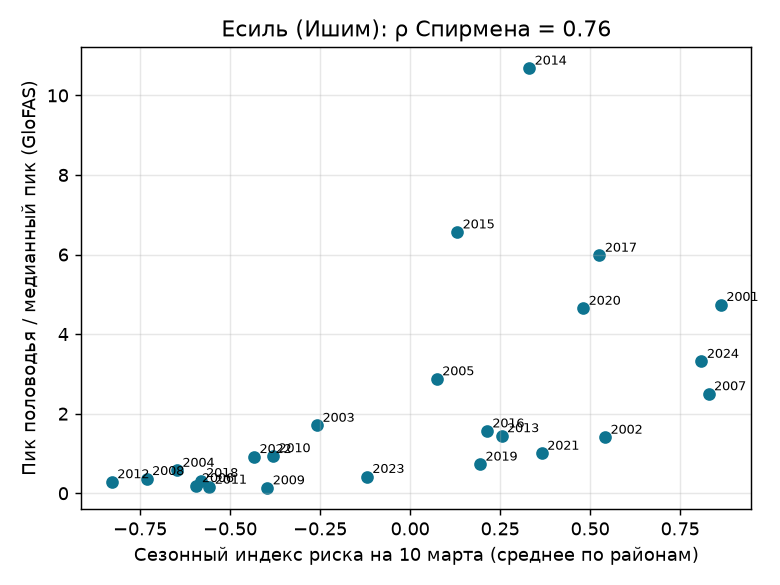
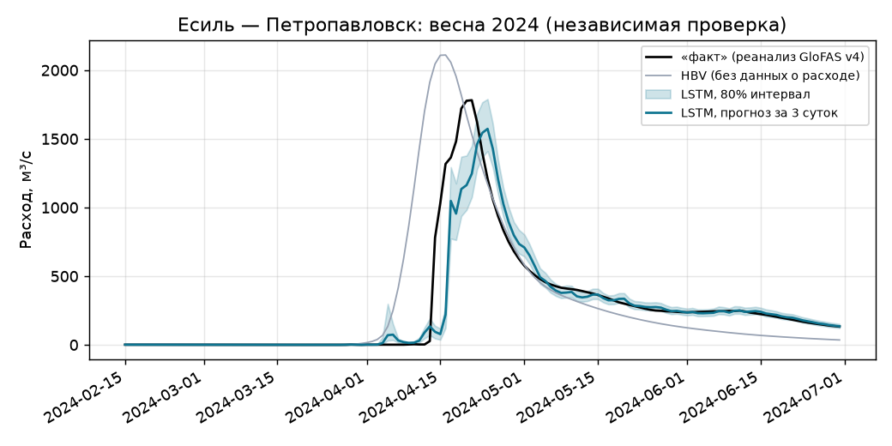
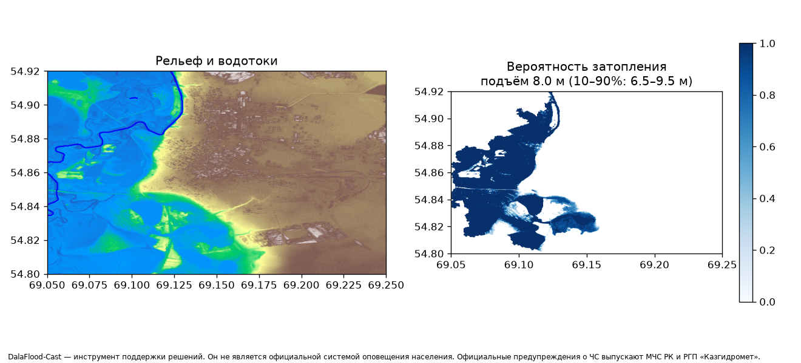
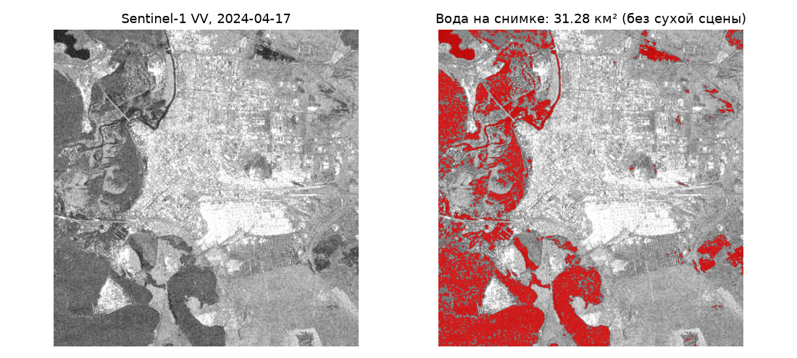

> **Доработка 2026-10-09:** Убраны bfill/интерполяция с будущими наблюдениями и подмена пропущенных целей. Неполные окна исключаются. HBV и кривая Q→H обучаются только до calib-from; конформная калибровка отделена от теста. Интервал не сужается отрицательной поправкой; кривая расходов монотонная. Добавлен архив выпущенных метеопрогнозов. Старые контрольные точки требуют явного --allow-legacy-research-model для воспроизведения.
>
> Подробности запуска, ограничения старых весов и критерии следующего этапа: [UPGRADE.md](UPGRADE.md).

# 🌊 DalaFlood-Cast


> ⚠️ **Важно.** DalaFlood-Cast — инструмент **поддержки решений** для акиматов, гидрологов и волонтёрских штабов. Он **не является официальной системой оповещения населения**. Официальные предупреждения о чрезвычайных ситуациях в Республике Казахстан выпускают МЧС РК и РГП «Казгидромет».

## 📌 О проекте
**DalaFlood-Cast** — открытая система прогнозирования весенних паводков в бассейнах рек Есиль (Ишим), Нура, Тобол и Урал. Она объединяет данные о снеге и почве, метеопрогнозы, расходы рек и модель рельефа, чтобы оценить:
1. **сколько воды придёт** с талым снегом (сезонный индекс риска по районам, за 2–8 недель);
2. **расход и уровень воды на гидропостах** на ближайшие 72 часа;
3. **какие территории могут быть затоплены** при прогнозируемом уровне.

> **Статус: рабочий прототип на реальных открытых данных.** Сезонный индекс, ретроспективная проверка, модели стока, карты HAND и Sentinel-1 считаются по реальным данным ERA5-Land, ERA5, GloFAS, Copernicus DEM, OpenStreetMap и Sentinel-1. Расчёты по Есилю лежат в `results/`. Главное ограничение: в открытом доступе нет рядов гидропостов Казгидромета, поэтому модели уровня обучены на реанализе GloFAS. С данными постов они переобучаются одной командой.

## 🎯 Решаемая проблема
Весной 2024 года паводки в Казахстане стали одними из крупнейших за десятилетия. Причиной стало редкое сочетание факторов, которое заранее было видно по данным: переувлажнение почвы осенью, промерзание, большой запас снега и быстрое потепление. Проект делает эти факторы видимыми **заранее**.

## 📊 Результаты на реальных данных

### 1. Ретроспективная проверка сезонного индекса (Есиль, 2001–2024)
Индекс считается на **10 марта** каждого года (без знания весны, климат — без оцениваемого года) по 12 районам и сравнивается с пиком половодья (март–июнь) на трёх постах (реанализ GloFAS).

* Ранговая корреляция индекса с пиком половодья: **ρ = 0.76** (p < 0.001, 24 года).
* **Весна 2024 г. — 3-е место из 24** по индексу на 10 марта.
* Во все годы с индексом ниже −0.1 пик половодья был низким: «спокойную» весну индекс показывает надёжно.



Индекс на 10 марта 2024 г. по районам ([`results/seasonal_esil_2023-2024.md`](results/seasonal_esil_2023-2024.md)): «высокий» — Атбасарский (+1.47), Есильский (+1.44), Жаксынский (+1.31), Астраханский (+1.06) районы Акмолинской области. Главный вклад — переувлажнение почвы осенью 2023 г. (z до +2.5) и запас воды в снеге (z до +1.6).

### 2. Сезонный индекс на весну 2026 г.
Индекс на 10 марта 2026 г. по 28 районам четырёх бассейнов ([`results/seasonal_*_2025-2026.md`](results/), карта — `web/index.html`): ни одного района в категориях «высокий» и «очень высокий». Максимумы «умеренные»: Карабалыкский р-н (+0.57, Тобол), Астраханский р-н и Астана (+0.45 / +0.43, Есиль). Сочетания факторов, как в 2024 г., нет ни в одном районе. Весна 2026 г. уже прошла, поэтому этот расчёт можно проверить по фактическому половодью.

### 3. Прогноз расхода на 72 ч (Есиль — Петропавловск)
Обучение — 2008–2017, калибровка интервала — 2018–2020, независимая проверка — 2021–2024 (включая паводок 2024 г.). Цель обучения — реанализ GloFAS в ячейке реки у Петропавловска; метеорология — средняя по точкам водосбора от Астаны до Петропавловска.

| Модель | NSE, 1 сут | NSE, 2 сут | NSE, 3 сут | Покрытие 80 %-го интервала (1 / 2 / 3 сут) |
|---|---|---|---|---|
| «Как вчера» | 0.968 | 0.902 | 0.810 | — |
| **LSTM** | **0.974** | **0.933** | **0.852** | 0.77 / 0.74 / 0.74 |
| HBV (без данных о текущем расходе) | — | — | — | KGE 0.86 на калибровке, 0.38 на проверке |

Ошибка пика половодья при прогнозе за 3 суток: 2021 г. +3 %, 2022 г. −7 %, 2023 г. −10 %, **2024 г. −12 %** (1 573 против 1 781 м³/с). Модель запаздывает на 2–3 суток: рост она видит, но не его резкость. HBV по одной лишь погоде воспроизводит величину пика 2024 г. (≈ 2 100 м³/с), но выдаёт его примерно на 5 суток раньше.



### 4. Зоны затопления: Петропавловск, апрель 2024
* **HAND по Copernicus DEM 30 м** с руслом из OpenStreetMap: сценарий подъёма воды 6.5 / 8 / 9.5 м над меженью. В зону вероятного затопления попали пойменные районы **Заречный** и **Тепличное** — их действительно затопило в апреле 2024 г.
* **Sentinel-1 (17.04.2024, пик паводка)**: 31.3 км² воды в окне 13×13 км. Совпадение с картой HAND: **IoU = 0.30**. Это честный, но скромный результат: окно маленькое, DEM 30 м не видит дамб и насыпей, а снимок в архиве один. После отказа Sentinel-1B съёмка Казахстана редкая, поэтому «сухой» референсной сцены той же орбиты нет и постоянные водоёмы не вычитаются.

| Вероятность затопления (HAND) | Вода на радарном снимке |
|---|---|
|  |  |

## 🔬 Факторы паводка, которые учитывает система
| Фактор | Почему важен | Источник данных в коде |
|---|---|---|
| **Запас воды в снеге** (SWE) | Объём талой воды | ERA5-Land: высота снега × плотность (250 кг/м³); снегопады ERA5 |
| **Осенняя влажность почвы** | Переувлажнённая почва не впитывает талую воду | ERA5-Land, слои 0–7 и 7–28 см, 15 октября – 30 ноября |
| **Глубина промерзания** | Мёрзлая почва работает как асфальт | ERA5-Land: переход температуры через 0 °C по профилю 0–255 см |
| Скорость потепления, осадки | Резкое потепление — резкий пик | ERA5 (история), прогноз Open-Meteo на 16 суток |
| Расходы рек, трансграничный сток | Урал и Тобол приходят из России | GloFAS v4: реанализ с 1984 г. и ансамблевый прогноз |
| Ледовые заторы, водохранилища | Локальный подъём воды | Не моделируются (см. ограничения) |

## ⚙️ Архитектура и модули
```
[Снег, почва, промерзание (ERA5-Land)]──┐
[Метеопрогноз Open-Meteo, 16 сут]───────┤
[Расходы GloFAS / гидропосты]───────────┼──▶ [HBV + LSTM] ──▶ Расход и уровень на постах (72 ч, интервал 10–90 %)
                                        │                                │
                                        ▼                                ▼
                     Сезонный индекс риска по районам     [Copernicus DEM + HAND + русла OSM] ──▶ Вероятность затопления
                                                                         │
                                                                         ▼
                                       [Населённые пункты OSM] ──▶ HTML-отчёт для акимата / штаба
```
| Модуль | Что делает |
|---|---|
| `dalaflood/seasonal.py` | Факторы риска по району и зиме, z-оценки к климату района, индекс, флаг «сочетание как в 2024 г.», ретроспектива |
| `dalaflood/hbv.py` | Модель стока HBV (снег по градусо-дням, почва, сток, трансформация) с **подавлением инфильтрации на мёрзлой почве**; калибровка дифференциальной эволюцией по KGE |
| `dalaflood/level.py` | LSTM: 30 суток истории + прогноз погоды → квантили расхода на 1–3 суток; кривая расходов Q→H |
| `dalaflood/hand.py` | Заполнение понижений (priority-flood), D8, накопление стока, HAND, прожиг русла, вероятность затопления по квантилям уровня |
| `dalaflood/s1.py` | Sentinel-1 RTC через STAC: порог Оцу, маска рельефа, изменение относительно сухой сцены, IoU |
| `dalaflood/impact.py` | Населённые пункты и реки OpenStreetMap (Overpass), экспозиция |
| `dalaflood/data/` | Open-Meteo (ERA5, ERA5-Land, GloFAS, прогноз) с дисковым кэшем; Copernicus DEM из открытого бакета AWS |
| `scripts/report.py` | Сводный HTML-отчёт с дисклеймером и официальными каналами МЧС / Казгидромета |
| `web/index.html` | Веб-карта сезонного риска по районам (статический сайт, подходит для GitHub Pages) |

## 🚀 Быстрый старт
```bash
git clone https://github.com/Turubayev/DalaFlood-Cast.git
cd DalaFlood-Cast
python -m venv .venv && source .venv/bin/activate
pip install --extra-index-url https://download.pytorch.org/whl/cpu -r requirements.txt

# Сезонные факторы риска для бассейна Есиля (или --basin all)
python scripts/seasonal_risk.py --basin esil --season 2025-2026

# Ретроспективная проверка индекса на 2001–2024
python scripts/hindcast.py --basin esil

# Модели стока для поста и оперативный прогноз на 72 ч
python scripts/train_level.py --gauge esil_petropavl
python scripts/forecast_level.py --gauge esil_petropavl

# Зона возможного затопления по рельефу (Copernicus DEM + русла OSM)
python scripts/flood_map.py --bbox 69.05 54.80 69.25 54.92 --rise 6.5 8 9.5 --name petropavl --settlements

# Карты затопления по Sentinel-1 за период + сравнение с HAND
python scripts/flood_extent_s1.py --aoi data/aoi/petropavl.geojson --start 2024-03-25 --end 2024-05-15 \
    --compare-prob results/flood_prob_petropavl.tif

# Отчёт для штаба и веб-карта
python scripts/report.py --basin esil --season 2025-2026
python -m http.server 8000 --directory web
pytest -q
```
Ключи не нужны. Open-Meteo бесплатен для некоммерческого использования, но ограничивает число запросов в час: ответы кэшируются в `data/cache/`, и повторный запуск продолжает загрузку с места остановки.

Посты: `esil_astana`, `esil_yavlenka`, `esil_petropavl`, `nura_kievka`, `tobol_kostanay`, `ural_uralsk`, `ural_atyrau`, `ilek_aktobe`. Данные поста (если есть): `train_level.py --obs file.csv` (`date,q[,h]`). По этим данным подбирается и кривая расходов.

## 📏 Метрики и проверка
| Задача | Метрика | Где |
|---|---|---|
| Прогноз расхода | NSE, KGE, ошибка пика по высоте и времени, покрытие интервала | `results/level_<пост>.json` |
| Зоны затопления | IoU / CSI с картами Sentinel-1 | `flood_extent_s1.py --compare-prob` |
| Сезонный индекс | Ранговая корреляция с пиком половодья, место 2024 г. | `results/hindcast_<бассейн>.json` |
| Сравнение | «Как вчера» и ансамбль GloFAS | `train_level.py`, `forecast_level.py` |

**Ключевой тест — паводок 2024 г.** Модели обучаются на годах до 2021 г. и проверяются на 2021–2024 гг. без подглядывания.

## 🚧 Ограничения
* Нет открытых рядов гидропостов: модели стока обучены на **реанализе GloFAS** (это модель, а не наблюдения). Уровни пересчитываются по кривой-заглушке, пока она не подобрана по данным поста.
* Режим сбросов водохранилищ, ледовые заторы и разрушения дамб не моделируются.
* DEM 30 м не видит мелкие дамбы и насыпи; в населённых пунктах нужна уточнённая съёмка (`flood_map.py --dem`).
* Карта зон затопления показывает **вероятность**, а не точную границу.
* Координаты районов (центры) и постов — ориентировочные; точки постов автоматически «притягиваются» к ячейке реки GloFAS.
* Промерзание по ERA5-Land может отличаться от наблюдаемого: в 2024 г. глубокий снег утеплял почву, и реанализ показывает промерзание ниже нормы.

## 🔐 Ответственное использование
* Прогнозы публикуются с интервалами неопределённости, без формулировок «затопит / не затопит».
* В каждом отчёте — ссылка на официальные каналы МЧС и Казгидромета.
* Данные о дамбах и уязвимых объектах не публикуются в детальном виде (только агрегаты).

## 🗺 Roadmap
**Этап 1. Данные и ретроспектива**
- [x] ERA5-Land, ERA5, GloFAS по бассейнам за 2001–2024 гг. (кэш)
- [x] Карта воды по Sentinel-1 за весну 2024 г. (Петропавловск)
- [x] Анализ факторов паводка 2024 г.: что было видно заранее

**Этап 2. Сезонный индекс риска**
- [x] Индекс риска по районам (снег, влажность, промерзание, снегопады)
- [x] Проверка на 2001–2024 гг. (Есиль)
- [ ] Проверка для Нуры, Тобола, Урала

**Этап 3. Оперативный прогноз**
- [x] Базовые модели («как вчера», ансамбль GloFAS)
- [x] HBV + LSTM для прогноза расхода на постах
- [x] Зоны затопления через HAND для пилотного участка
- [ ] Обучение на рядах гидропостов Казгидромета

**Этап 4. Пилот**
- [x] Веб-карта и отчёт для штабов и акиматов
- [ ] Партнёрство с Казгидрометом / территориальными подразделениями МЧС
- [ ] Учёт ледовых заторов и водохранилищ

## 🤝 Участие
Нужны: гидрологи, специалисты ДЗЗ, представители акиматов и волонтёрских штабов. См. [`CONTRIBUTING.md`](CONTRIBUTING.md).

## 📄 Лицензия
Код — **Apache 2.0**. Данные: ERA5/ERA5-Land, GloFAS, Copernicus DEM, Sentinel-1 — © Copernicus / ECMWF / ESA на условиях открытых лицензий; Open-Meteo — CC BY 4.0; OpenStreetMap — ODbL.
